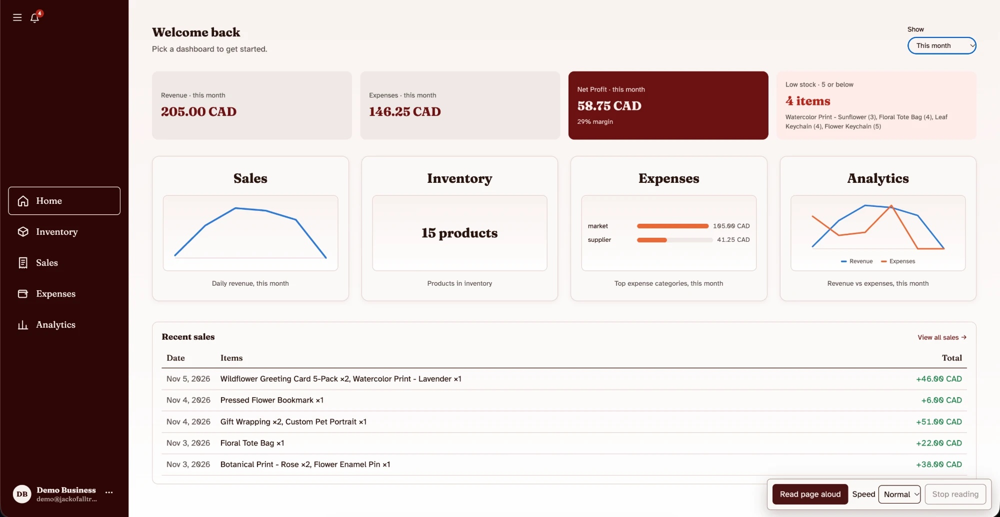
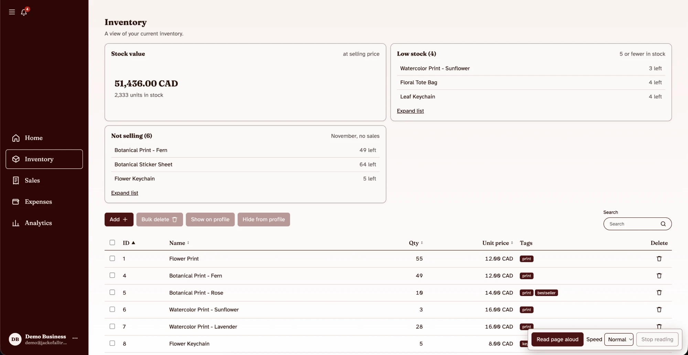
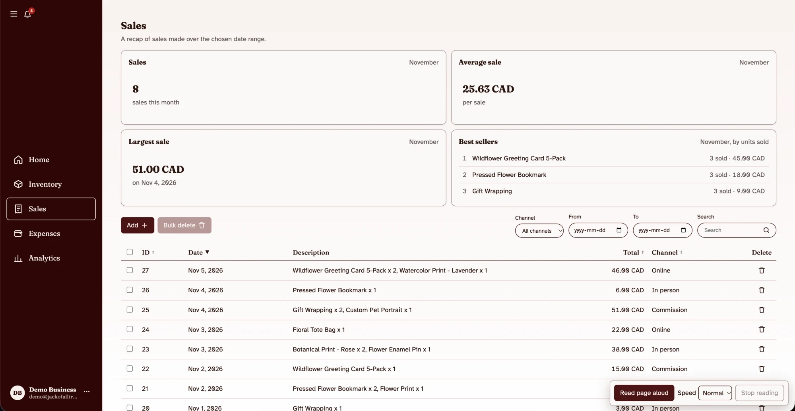
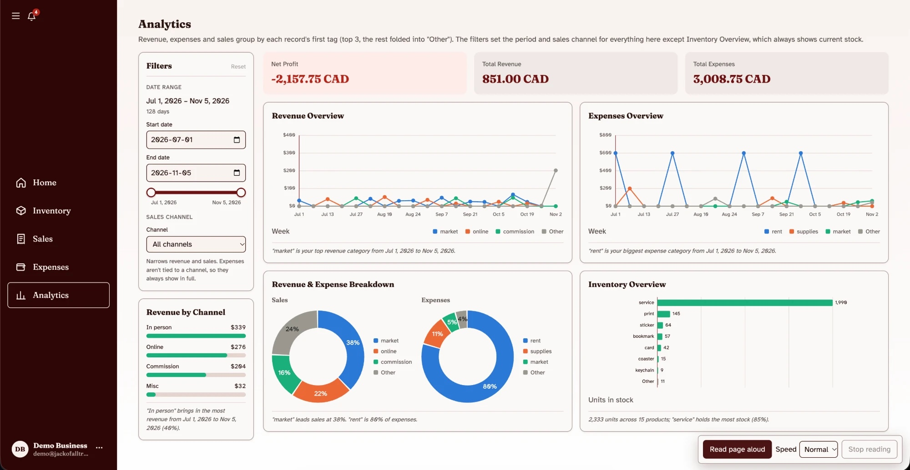
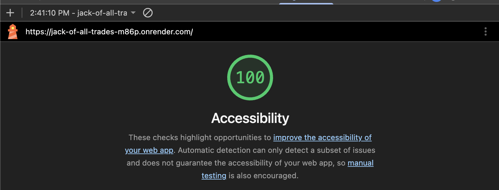
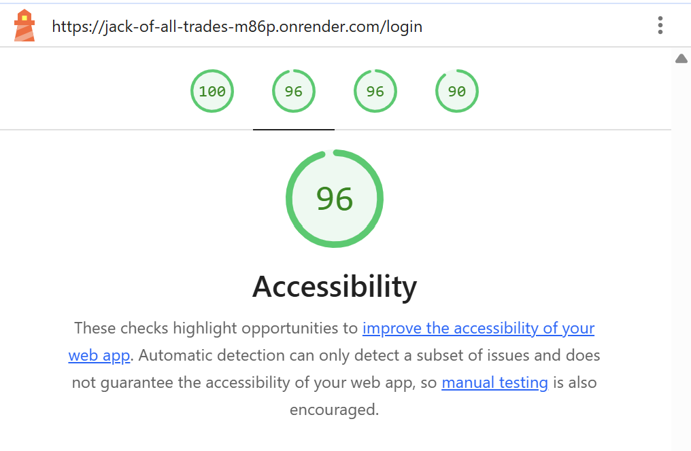

# Jack-Of-All-Trades

## Description About The Project

 * Jack-Of-All-Trades is a business management and intelligence platform targeted at small businesses, entrepreneurs, and independent creators.
 * Starting out a small business may often be daunting, as you have to manage sales, track inventory, and figure out your own analytics.
 * As such, our application aims to simplify the accounting & inventory management process, as well as provide analytics and projections for business performance.
​
## Try It Now

**Live app: https://jack-of-all-trades-m86p.onrender.com** (no install needed)

Log in with the demo account, a sample floral and stationery shop with products, sales and expenses:

```
email:    demo@jackofalltrades.test
password: ChangeMe123!
```

...or click **Register** to create your own business. Every page only ever shows your own business's data.

## What's New in D3

D3 turns the dashboards into answers: filter Sales by channel and dates, explore any period of your history on Analytics (date slider, channel filter, Revenue by Channel), and switch Home between the week, month or year. Owners can also set their account currency, see which products aren't selling, and manage their account, channels and alerts in Settings. The full analysis is in the [product evolution report](deliverables/D3/product-evolution.md).

### Response to D2 Feedback

| TA feedback at the D2 demo | What we changed | Where to see it |
| --- | --- | --- |
| Make fonts and colours consistent | One heading font, one readable body font (Atkinson Hyperlegible) and shared colours ([#9](https://github.com/dakhmedova30/18-Jack-Of-All-Trades/pull/9), [#14](https://github.com/dakhmedova30/18-Jack-Of-All-Trades/pull/14), [#22](https://github.com/dakhmedova30/18-Jack-Of-All-Trades/pull/22)) | Every page |
| Make widgets consistent; show which items are low or not selling | One shared summary card, plus **Low stock** and **Not selling** panels ([#9](https://github.com/dakhmedova30/18-Jack-Of-All-Trades/pull/9), [#22](https://github.com/dakhmedova30/18-Jack-Of-All-Trades/pull/22)) | Inventory |
| Put stock value and low stock, and this month and best sellers, at the top | Moved above the tables ([#9](https://github.com/dakhmedova30/18-Jack-Of-All-Trades/pull/9)) | Inventory, Sales |
| Change the cards' font | Card figures use the heading font ([#9](https://github.com/dakhmedova30/18-Jack-Of-All-Trades/pull/9), [#14](https://github.com/dakhmedova30/18-Jack-Of-All-Trades/pull/14)) | Inventory, Sales |
| Add tests | 237 backend and 56 frontend tests, run on every pull request ([#10](https://github.com/dakhmedova30/18-Jack-Of-All-Trades/pull/10), [#18](https://github.com/dakhmedova30/18-Jack-Of-All-Trades/pull/18)) | [Running tests](#running-tests) |

## Core Workflows (What to Try)

Log in as the demo account, then:

1. **Home:** use **Show** (top right) to switch between the last 7 days, this month, this year and the last 12 months; the tiles and card previews follow. A new account shows "No sales yet this month" instead of bare zeros.
2. **Sales:** click **Add** to record a sale: pick a date, a channel and one or more items. Totals come from each item's price, and stock goes down automatically. Use the **Channel** and date filters above the table to find, for example, last December's Online sales.
3. **Inventory:** add or edit products. The cards at the top show the stock value, **Low stock**, and **Not selling** (in stock, but no sales this month).
4. **Expenses:** click **Add** to record a cost. Each line either restocks a product (its stock goes up) or is a free-text cost such as rent.
5. **Analytics:** pick any period with the date fields or the slider, and narrow revenue to one channel. **Revenue by Channel** shows where the money comes from; Net Profit shows "—" while a channel is selected, since expenses have no channel.
6. **Settings:** change the account **currency** (preview first, then convert prices or only relabel them); rename channels and expense tags and set the low-stock cutoff (Preferences); choose which alerts appear in the bell (Notifications); and switch the theme or text size (Appearance).
7. **Public profile:** in Settings > Profile, set a link name (e.g. `demo-shop`) and click **Turn on**, then tick **Show on my public profile** on products (or select several in Inventory and click **Show on profile**). Customers open `/p/demo-shop` with no account, and never see contact details or stock counts, only "In stock" or "Sold out".
8. **Read aloud:** the bar at the bottom of every page reads it out, one highlighted passage at a time.

### Screenshots

**Home:** this month's revenue, expenses, profit and low stock, with the **Show** period choice (top right).



**Inventory:** stock value, **Low stock** and **Not selling** panels above the product table.



**Sales:** this month at a glance and best sellers, then the channel and date filters above the sales table.



**Analytics:** the period and channel filters, Revenue by Channel, and the overview charts.



## Non-Functional Requirements

### Accessibility

- **Lighthouse accessibility** on the live site (Chrome DevTools, desktop, Nov 6, 2026): Home **100**, Inventory **100**, Sales **100**, Expenses **100**, Analytics **96-100**, Login **96**.

  
  

- **Keyboard:** every workflow above works with Tab, Enter and Esc. Dialogs start on their first field, keep focus inside, and return it to the button that opened them ([#9](https://github.com/dakhmedova30/18-Jack-Of-All-Trades/pull/9), [#14](https://github.com/dakhmedova30/18-Jack-Of-All-Trades/pull/14)).
- **Forms:** every field has a label; an error is tied to its field and read out by screen readers, and login and registration errors say what to fix ([#20](https://github.com/dakhmedova30/18-Jack-Of-All-Trades/pull/20)).
- **Orientation:** each page has its own title, so screen readers announce where you are.
- **Reading:** a body font designed for low-vision readers ([#22](https://github.com/dakhmedova30/18-Jack-Of-All-Trades/pull/22)), a text-size setting and dark mode (Settings > Appearance), reduced motion when the system asks for it, and a read-aloud reader ([#17](https://github.com/dakhmedova30/18-Jack-Of-All-Trades/pull/17)).

### Security

- **Passwords** are hashed with BCrypt and must be at least 8 characters. Changing your email or password needs the current password and signs out your other devices.
- **Sessions** use an HttpOnly, SameSite=Lax cookie (Secure over HTTPS). Every `/api` endpoint except login, registration, the health check and public profiles requires a login.
- **Authorization:** the server takes the business only from the session, never from the request, and every query is scoped to it. Asking for another business's record returns 404; each module has a test for this.
- **Input validation:** every request body is validated, with a message per field (e.g. a price must be between 0.00 and 9,999,999.99, and quantities reject `2.7` and `"5"`).
- **SQL injection:** every query uses named parameters; sort columns come from a fixed list.
- **Errors never expose internals:** clients get a short JSON message, e.g. `{"error":{"message":"Log in to continue"}}`; an unexpected error returns `"Internal server error"`, with details only in the server log.
- **No secrets in the repo:** configuration comes from environment variables (templates in `backend/.env.example` and `demo/client/.env.example`); the deploy hook is a GitHub secret. Public profiles return only an allowlist of fields.

### Production Readiness

- **CI/CD:** every pull request runs lint, type checks, both test suites and a build, each job with a time limit; `main` deploys only after they pass ([Actions](https://github.com/dakhmedova30/18-Jack-Of-All-Trades/actions)).
- **Health and failures:** Render checks `/api/health`; if the database is down, requests fail fast with "Database is unavailable, try again shortly" (503) instead of hanging; if exchange rates can't load, the app falls back to cached or bundled rates.
- **Repeatable deploys:** one Docker image serves the API and the web app, and Flyway applies database migrations on startup ([Deploying to Render](#deploying-to-render)).

## Development Requirements

### Prerequisites

 * macOS, Linux or Windows
 * Git
 * [Java 25](https://adoptium.net/) and the Maven wrapper (`backend/mvnw`, no separate Maven install needed). Check with `java -version`. On macOS, Homebrew doesn't make Java 25 the default, so after `brew install openjdk@25` run this in each new terminal (otherwise the build fails with "release version 25 not supported"):

   ```bash
   export JAVA_HOME="$(brew --prefix openjdk@25)/libexec/openjdk.jdk/Contents/Home"
   ```
 * [Node.js](https://nodejs.org/) 22.13 or newer (24 LTS works too; `nvm use` reads `.nvmrc`) and npm 10+, to build/run `demo/client`
 * A PostgreSQL database, either hosted (Neon, AWS RDS, Supabase, ...) or local (`docker compose up -d` in `backend/`)

### Tech stack

| Layer    | Technology                                                                 |
| -------- | --------------------------------------------------------------------------- |
| Frontend | React 19, TypeScript, Vite, React Router                                  |
| Backend  | Java 25, Spring Boot 4, Spring Security, Spring Data JPA / `JdbcClient`, Flyway, BCrypt, Maven |
| Database | PostgreSQL (Neon in production)                                           |
| Hosting  | Render (one Docker web service)                                           |
| Tooling  | ESLint, Prettier (frontend); JUnit 5 + Testcontainers (backend tests)      |

### Setup

```bash
git clone <repo-url> jack-of-all-trades
cd jack-of-all-trades

# 1. Local Postgres for the backend (runs on :5433, no setup needed)
cd backend && docker compose up -d && cd ..

# 2. Backend — seeds the demo account with sample data, picks up the local Postgres above by default
cd backend && SPRING_PROFILES_ACTIVE=demo ./mvnw spring-boot:run
# in a second terminal:
cd demo && npm install && npm run dev -w client   # web app on http://localhost:5173
```

No Docker? Point the backend at any hosted Postgres instead by setting `SPRING_DATASOURCE_URL`, `SPRING_DATASOURCE_USERNAME` and `SPRING_DATASOURCE_PASSWORD` (copy `backend/.env.example`; see [Configuration](#configuration)) before `./mvnw spring-boot:run`. Flyway creates the schema automatically on first connect either way.

The app requires a login. Register your own business account on first run, or log in as the seeded demo account, which starts with sample products, about six weeks of sales and some expenses:

```
email:    demo@jackofalltrades.test
password: ChangeMe123!
```

Open http://localhost:5173. In development the Vite dev server forwards `/api/*` to the backend on `:4000`. In production, the backend itself serves the built React app and the API from one URL.

### Scripts

Frontend (run from `demo/`, not the repo root — there is no root `package.json`):

| Command             | What it does                      |
| ------------------- | ---------------------------------- |
| `npm run dev`       | Runs the web app with hot reload   |
| `npm test`          | Runs the frontend tests (Vitest)   |
| `npm run typecheck` | Type-checks the client             |
| `npm run lint`      | Runs ESLint                        |
| `npm run format`    | Formats everything with Prettier   |
| `npm run build`     | Builds `client/dist`               |

Backend (run from `backend/`):

| Command                          | What it does                                          |
| --------------------------------- | ------------------------------------------------------ |
| `./mvnw spring-boot:run`          | Runs the API (add `SPRING_PROFILES_ACTIVE=demo` to seed the demo account) |
| `./mvnw test`                     | Runs the JUnit/Testcontainers test suite (needs Docker) |
| `./mvnw -DskipTests package`      | Builds the jar (used by `backend/Dockerfile`)           |
| `docker compose up -d`            | Starts local Postgres on `:5433` for development        |

### Running tests

The backend has a JUnit 5 test suite (237 tests) covering the API endpoints, input
validation, auth and sessions, and the sales, expense, analytics and notification
calculations. Tests run against a real PostgreSQL that Testcontainers starts in Docker, so
there's no database to set up.

You'll need Java 25 and a running Docker (Docker Desktop, OrbStack or colima).

```bash
cd backend
./mvnw test
```

A passing run ends with `Failures: 0, Errors: 0` and `BUILD SUCCESS`. The first run downloads
Maven dependencies and the Postgres image, so it takes a few minutes; after that it's about a
minute.

The frontend has a Vitest suite with React Testing Library, covering login and registration,
protected routes, the inventory, sale and expense forms, Analytics, and the date and money
helpers. It runs in a simulated browser (jsdom) with the API mocked, so it needs neither
Docker nor the backend:

```bash
cd demo
npm test
```

Both suites run in GitHub Actions ([`.github/workflows/ci.yml`](.github/workflows/ci.yml))
on every pull request into `main` and every push to `main`, and a merge only deploys if they
pass. See recent runs in the [Actions tab](https://github.com/dakhmedova30/18-Jack-Of-All-Trades/actions).

### Project structure

```
demo/
  client/                    React app
    src/api/                 fetch wrappers, one file per resource
    src/components/          shared UI: layout, modal, pagination, icons
    src/hooks/                data-loading hooks (useItems)
    src/pages/                one folder per dashboard
    src/styles.css            design tokens + styles from the Figma wireframe
backend/                     Java/Spring Boot API
  src/main/java/ca/jackofalltrades/<feature>/   controller -> service -> repository
  src/main/resources/db/migration/              Flyway SQL migrations
  src/test/java/                                 JUnit 5 + Testcontainers tests
  compose.yaml                                    local Postgres for development
  render.yaml                                      Render deployment config
docs/
  api-contracts.md           the API contract the backend implements
```

Each feature follows the same layers: **controllers** handle HTTP only, **services** hold business rules, **repositories** hold all SQL. A new feature should copy an existing one, e.g. `backend/src/main/java/ca/jackofalltrades/items`, and should be added to `docs/api-contracts.md` to keep it accurate.

### API

See [`docs/api-contracts.md`](docs/api-contracts.md) for the authoritative, endpoint-by-endpoint spec. The summary below covers the same contract.

All error responses share one shape: `{ "error": { "message": string, "details"?: [{ "field", "message" }] } }`. Money is always sent as integer cents.

Every route except `/api/health`, `/api/auth/*` and the read-only `/api/public/*` requires a logged-in session
(a cookie set by register/login) and returns 401 without one. Items, sales,
expenses, channels, expense tags and analytics are all scoped to the logged-in
business: one business can never see or modify another's data, even by
guessing an id in the URL.

| Method | Endpoint                 | Description                                |
| ------ | ------------------------ | ------------------------------------------ |
| GET    | `/api/health`            | Health check (also checks the database)    |
| POST   | `/api/auth/register`     | Create a business account, logs you in     |
| POST   | `/api/auth/login`        | Log in (`{ email, password }`)             |
| POST   | `/api/auth/logout`       | Log out                                    |
| GET    | `/api/auth/me`           | The logged-in business, or 401             |
| GET    | `/api/items`             | List items (`page`, `pageSize`, `search`)  |
| GET    | `/api/items/:id`         | Get one item                               |
| POST   | `/api/items`             | Create item                                |
| PATCH  | `/api/items/:id`         | Update some fields of an item              |
| DELETE | `/api/items/:id`         | Delete item                                |
| POST   | `/api/items/bulk-delete` | Delete several items (`{ "ids": [1, 2] }`) |
| GET    | `/api/sales`             | List sales (`page`, `pageSize`, `search`)  |
| GET    | `/api/sales/:id`         | Get one sale                               |
| POST   | `/api/sales`             | Record a sale (decrements item stock)      |
| PATCH  | `/api/sales/:id`         | Replace a sale's date, tags and line items |
| DELETE | `/api/sales/:id`         | Delete a sale (restores item stock)        |
| POST   | `/api/sales/bulk-delete` | Delete several sales (`{ "ids": [1, 2] }`) |
| GET    | `/api/expenses`             | List expenses (`page`, `pageSize`, `search`)  |
| GET    | `/api/expenses/:id`         | Get one expense                               |
| POST   | `/api/expenses`             | Record an expense (restocks any linked items) |
| PATCH  | `/api/expenses/:id`         | Replace an expense's date, tags and lines     |
| DELETE | `/api/expenses/:id`         | Delete an expense (undoes any restock)        |
| POST   | `/api/expenses/bulk-delete` | Delete several expenses (`{ "ids": [1, 2] }`) |
| GET    | `/api/analytics/summary`    | Dashboard totals and charts (`range`, default `12months`) |
| GET    | `/api/public/businesses/:slug`      | A business's public profile and public items (**no login needed**) |
| GET    | `/api/public/businesses/:slug/logo` | That business's logo (**no login needed**)                   |

A sale is one transaction: a date, optional tags, and one or more line items
(`{ itemId, quantity }`). Each line's unit price is snapshotted from the item at
sale time, so editing an item's price later doesn't change past sales.

An expense is the same shape, but each line is `{ itemId?, description?, quantity, unitCostCents }`
and must give exactly one of `itemId` or `description`: an `itemId` line restocks
that item (adds `quantity` to its stock, using the unit cost you paid, not the
item's sale price); a `description` line (e.g. `"Rent"`) is a free-text cost with
no stock effect. Editing or deleting an expense undoes its restock first, so if
the restocked stock has since been sold below that amount, the edit/delete is
rejected with a 400 rather than letting stock go negative.

Analytics groups sales and expenses by each record's first tag (top 3 by value;
the rest fold into "Other"). `range` is one of `week` (last 7 days), `month`
(month-to-date, by day), `ytd` (year-to-date, by month), or `12months` (default,
trailing 12 months) — it's the one page-wide window: Revenue Overview, Expenses
Overview, the Sales Overview donut, and Net Profit/Revenue/Expenses are all
scoped to it, so changing it moves the whole page together.

### Configuration

Every variable is optional. Without any of them, `backend/src/main/resources/application.yml` defaults to the local Docker Postgres from `docker compose up -d`, so the [Setup](#setup) steps work as-is.

Templates with every variable and a comment for each are committed as `backend/.env.example` and `demo/client/.env.example`. To use them, copy each to `.env` next to it, then uncomment and fill in only the variables you need (an unedited copy changes nothing). Both `.env` files are gitignored; **never commit real credentials**, and never put them in the `.env.example` files.

```bash
cp backend/.env.example backend/.env
cp demo/client/.env.example demo/client/.env
```

Spring Boot doesn't read `.env` on its own, so load it into your shell before starting the backend (or paste the values into your IDE's run configuration):

```bash
cd backend && set -a && source .env && set +a && ./mvnw spring-boot:run
```

Vite reads `demo/client/.env` by itself when `npm run dev` or `npm run build` starts.

**Backend** (`backend/.env`; on Render, the service's **Environment** tab):

| Variable                      | Required | Description                                                                 |
| ------------------------------ | -------- | --------------------------------------------------------------------------- |
| `SPRING_DATASOURCE_URL`        | No       | `jdbc:postgresql://host/dbname?sslmode=require`. Default: `jdbc:postgresql://localhost:5433/jack` |
| `SPRING_DATASOURCE_USERNAME`   | No       | Default: `jack`                                                              |
| `SPRING_DATASOURCE_PASSWORD`   | No       | Default: `jack`                                                              |
| `SPRING_PROFILES_ACTIVE`       | No       | Set to `demo` to seed the demo account on startup                           |
| `PORT`                         | No       | Defaults to 4000 (Render sets it automatically)                             |

**Client** (`demo/client/.env`, read at build time):

| Variable              | Required | Description                                                                              |
| --------------------- | -------- | ---------------------------------------------------------------------------------------- |
| `VITE_SUPPORT_EMAIL`  | No       | Support address shown on the Help page. Leave it empty to show a generic "ask the person who set up this app" line instead. Anything prefixed `VITE_` is visible in the browser, so never put secrets in client variables. |

### Deploying to Render

1. Create a Neon (or other hosted Postgres) database and copy its connection string.
2. In Render: since this repo isn't owned by the account deploying it, use **New > Web Service > Public Git Repository** (rather than **New > Blueprint**) and paste this repo's URL. (If you fork the repo into your own GitHub account, **New > Blueprint** on your fork reads `backend/render.yaml` and fills in steps 3–6 for you. You're still asked for the three `SPRING_DATASOURCE_*` values.)
3. Language: **Docker**. Dockerfile Path: `backend/Dockerfile`. Docker Build Context Directory: leave as `.` (the repo root — the Dockerfile needs both `backend/` and `demo/client/`).
4. Health Check Path: `/api/health` (exactly — a trailing/duplicated path here will make every deploy time out waiting on the health check).
5. Environment variables: `SPRING_DATASOURCE_URL` (JDBC form, e.g. `jdbc:postgresql://<host>/<db>?sslmode=require`), `SPRING_DATASOURCE_USERNAME`, `SPRING_DATASOURCE_PASSWORD`, and `SPRING_PROFILES_ACTIVE=demo`.
6. The free instance type's 0.1 CPU is too slow to boot the JVM within Render's health-check window — every free-tier deploy we tried either failed outright or took 15+ minutes. Use the $7/month instance (0.5 CPU), which boots in under a minute.
7. Deploys are triggered from GitHub Actions, not by Render itself: "Public Git Repository"
   services don't get webhooks from a repo they don't own. Instead, the `deploy` job in
   `.github/workflows/ci.yml` calls the service's Render **Deploy Hook** once the checks and
   tests pass on `main`. To set it up, copy the hook URL from Render (**Settings > Deploy Hook**)
   into a GitHub Actions secret named `RENDER_DEPLOY_HOOK_URL`. Never put it in the workflow
   file, because anyone with the URL can trigger a deploy. Manual redeploys still work via
   **Manual Deploy > Deploy latest commit**.

 ## Deployment and Github Workflow

 * Making Pull Requests for major changes with at least one member from the subteam looking over it before merging.
     * Ex: if the PR is a backend change, another backend member will look it over.
     * This allows a fresh set of eyes to look over the functionalities and catch any potential bugs/edge cases that weren't covered in testing.
     * Additionally, this prevents unreviewed commits to production branch.
 * Branching Strategy and Naming Convention: all new work is developed on separate feature branches that branch off from *main*, named for the user story or feature they add.
     * Ex: `us1-sales`, `us2-inventory`, `allie/java-expenses`
     * This keeps each branch's purpose clear from its name, and keeps related commits for one feature together until it's reviewed and merged.
 * Deployment: the backend is deployed as a Render web service (see [Deploying to Render](#deploying-to-render)). Every merge to *main* deploys automatically once CI's checks and tests pass, so nothing is deployed that hasn't been reviewed and tested.
  

 ## Coding Standards and Guidelines
    
 * We use automated tools like Prettier and ESLint (TypeScript) to enforce consistent code styling and catch syntax errors; the Java backend follows standard Maven/Spring project conventions.
 * Our development strictly adheres to separation of concerns to ensure a clean & modular architecture between different system components
 * All developers must write code that have clear, descriptive function names and implement comprehensive error handing.
​
 ## Licenses
​
 MIT License

Copyright (c) 2026 Jack-Of-All-Trades Contributors

Permission is hereby granted, free of charge, to any person obtaining a copy
of this software and associated documentation files (the "Software"), to deal
in the Software without restriction, including without limitation the rights
to use, copy, modify, merge, publish, distribute, sublicense, and/or sell
copies of the Software, and to permit persons to whom the Software is
furnished to do so, subject to the following conditions:

<br>

The above copyright notice and this permission notice shall be included in all
copies or substantial portions of the Software.

<br>

THE SOFTWARE IS PROVIDED "AS IS", WITHOUT WARRANTY OF ANY KIND, EXPRESS OR
IMPLIED, INCLUDING BUT NOT LIMITED TO THE WARRANTIES OF MERCHANTABILITY,
FITNESS FOR A PARTICULAR PURPOSE AND NONINFRINGEMENT. IN NO EVENT SHALL THE
AUTHORS OR COPYRIGHT HOLDERS BE LIABLE FOR ANY CLAIM, DAMAGES OR OTHER
LIABILITY, WHETHER IN AN ACTION OF CONTRACT, TORT OR OTHERWISE, ARISING FROM,
OUT OF OR IN CONNECTION WITH THE SOFTWARE OR THE USE OR OTHER DEALINGS IN THE
SOFTWARE.
