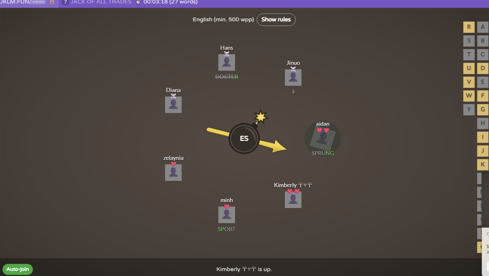
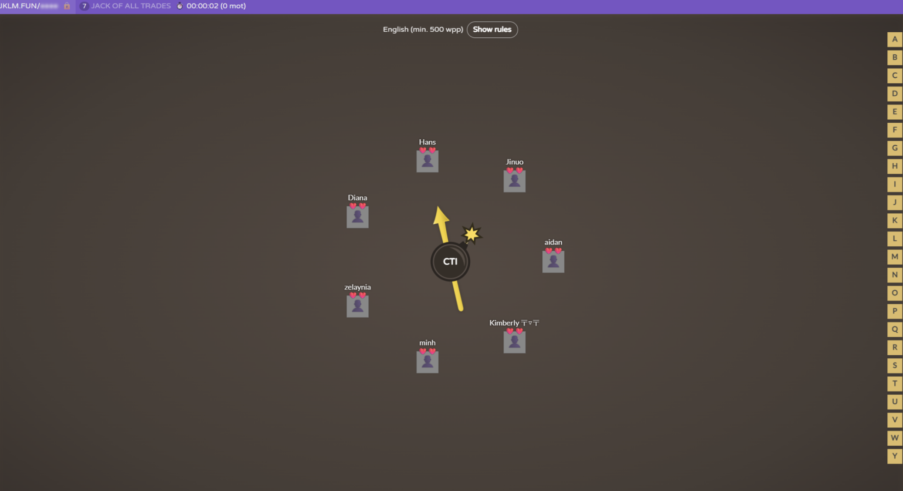
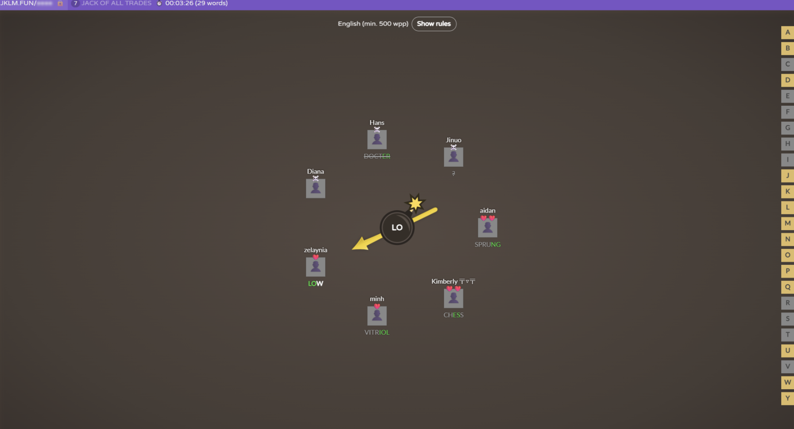

## September 28 Meeting Summary

Present: Diana Akhmedova, Kimberly Prijadi, Jinuo Tao, Minh Tran, Allie Huynh, Hans Santiago, Aidan Wang **(Complete)**

Worked on D1

- Filling out [Planning.md](http://Planning.md) together  
  - Splitted tasks: filling out the planning file, wireframing, etc.  
  - Discussed roles and tech stack  
  - Discussed team rules, accountability, and so on  
  - Discussed meeting times and how meetings will be run  
- Created the team csv and stakeholders text file  
- Created Figma team for demo  
  - [https\://www\.figma.com/folder\_invite/redeem/f9mqLWOAudzZjk7EnZCcfX](https://www.figma.com/folder_invite/redeem/f9mqLWOAudzZjk7EnZCcfX)  
- ~~Created Jira project for task management~~   
  - [~~https\://jack-of-all-trades.atlassian.net/?continue=https%3A%2F%2Fjack-of-all-trades.atlassian.net%2Fwelcome%2Fsoftware%3FprojectId%3D10001\&atlOrigin=eyJpIjoiNmJhODU0NDlhOWFmNDRiNjk1OWZhMDZhOWVmNjJhNjAiLCJwIjoiamlyYS1zb2Z0d2FyZSJ9~~](https://jack-of-all-trades.atlassian.net/?continue=https%3A%2F%2Fjack-of-all-trades.atlassian.net%2Fwelcome%2Fsoftware%3FprojectId%3D10001&atlOrigin=eyJpIjoiNmJhODU0NDlhOWFmNDRiNjk1OWZhMDZhOWVmNjJhNjAiLCJwIjoiamlyYS1zb2Z0d2FyZSJ9) 

Team building
|  |  |  |
